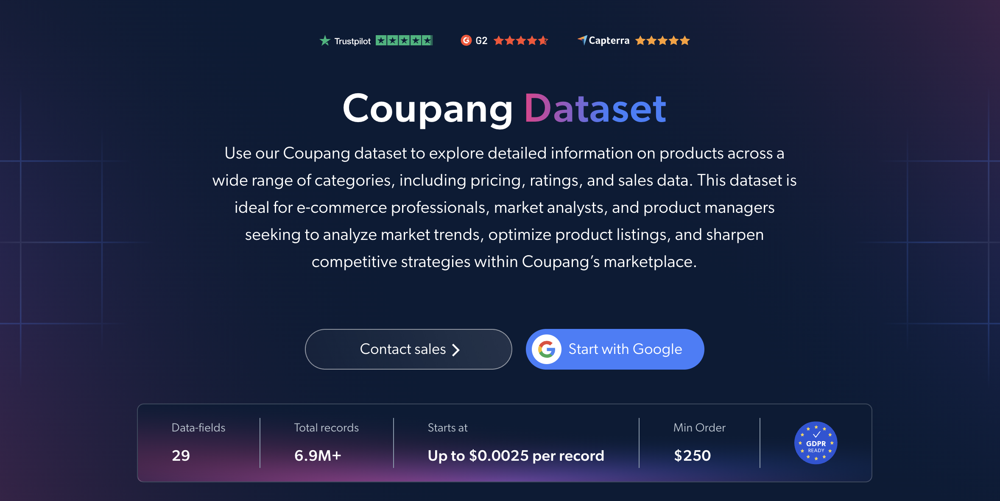

# Coupang-dataset-sample
<h2>A sample dataset of 1000 Coupang products</h2>

Coupang products dataset extracted using the Bright Data API.

Data points include:

- `url`
- `id`
- `title`
- `rating`
- `reviews`
- `discount`
- `currency`
- `seller_name`
- `shop_url`
- `seller_rating`
- `seller_reviews`
- `images`
- `main_image`
- `categories`
- `root_category`
- `root_category_url`
- `shipping_company`
- `shipping_details`
- `variations`
- `variant_id`
- `variant`

And a lot more.

Our Coupang Products (public data) dataset includes over **6,900,000 product records**, covering titles, ratings, reviews, discounts, seller information, category hierarchies, shipping options, product variations and images from Coupang, South Korea's largest e-commerce marketplace.

**File formats:** JSON, NDJSON, JSON Lines, CSV, XLSX or Parquet. Optionally compressed as .gz.

**Delivery options:** Snowflake, Amazon S3, Google Cloud, Azure, SFTP, or Webhook.

**Update frequency:** One-time purchase, or Daily, Weekly, Monthly, Quarterly or Biannual updates.

**Data enrichment:** Get only the records and fields you need by applying filters, or enrich the dataset with additional data points.

<a href="https://brightdata.com/products/datasets/coupang">Get the full Coupang dataset</a>

## Use cases

### Discount and promotion analysis
Use the `discount` field together with `shipping_details` (free shipping, Rocket delivery, conditional free shipping) to see how promotions and delivery offers vary across categories and sellers.

### Seller and marketplace analysis
Compare sellers by `seller_rating` and `seller_reviews`, and use `seller_name` and `shop_url` to see how first-party listings (such as Coupang Global) compare with third-party marketplace sellers.

### Customer sentiment and product performance
Use `rating` and `reviews` to benchmark product reception, spot top-rated products within a category, and track how review volume relates to discounts and delivery options.

### Category and assortment mapping
Use the full `categories` path, `root_category` and `variations` to map Coupang's catalog structure, compare assortment depth across verticals, and analyze product options such as size, color and quantity.

### Delivery and fulfillment insights
Analyze `shipping_company` and `shipping_details` to see which carriers (CJ Logistics, Hanjin, Lotte and others) and fulfillment models (Rocket, Global, seller-shipped) dominate each category.

## Bright Initiative

Bright Data offers its datasets for free to academic institutions and NGOs through the [Bright Initiative](https://brightinitiative.com/) program.
